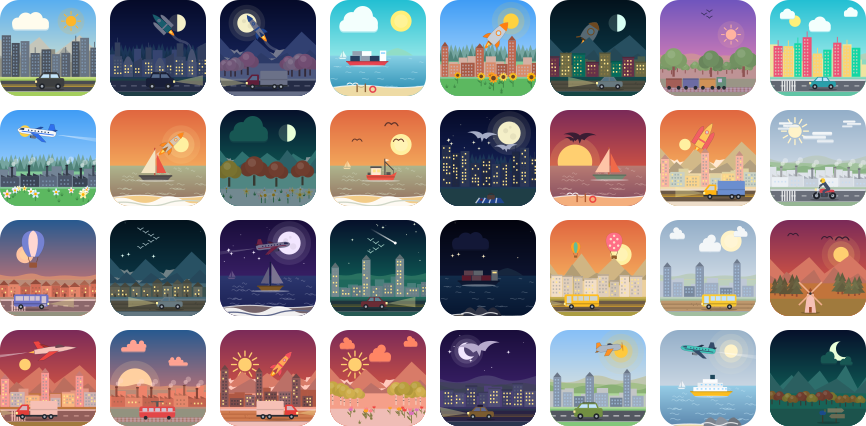

# vicon-avatars

**English** · [简体中文](./README.zh-CN.md)

Deterministic landscape icons. Give it any string (a user id, an email, a hash) and get back a small, hand-composed SVG scene: sky, sun or moon, clouds, planes, mountains, a skyline, a road with a bus on it. The same string always gives the same picture.

Think [Jdenticon](https://jdenticon.com), but instead of abstract shapes you get tiny worlds.



- **2.6 billion** reachable combinations (4.29 billion nominal), from 6 independent layers
- Pure SVG string output: no canvas, no images, no network. About 6–16 KB per icon
- Works in **vanilla JS, React, Vue, Angular** and as a **Web Component**
- Zero runtime dependencies, tree-shakeable, ships ESM + CJS + types
- Day, dusk and night palettes: windows light up, clouds and vehicles dim, stars come out

## Install

```bash
npm install vicon-avatars
```

## Usage

### Vanilla JS / Node

```js
import { toSvg } from 'vicon-avatars';

const svg = toSvg('alice@example.com', { size: 96, shape: 'circle' });
document.querySelector('#avatar').innerHTML = svg;
```

`toSvg` returns a complete `<svg>` string, so it also works on the server (SSR, emails, image generation).

### Node.js (server, scripts, CLI)

The core has no DOM dependency, so it runs unchanged in Node 16+ (ESM and CommonJS) and in SSR frameworks such as Next.js, Nuxt and Angular Universal.

```js
import { writeFileSync } from 'node:fs';
import { toSvg, toDataUri } from 'vicon-avatars';

writeFileSync('alice.svg', toSvg('alice@example.com', { size: 256 }));  // save a file
const src = toDataUri('alice@example.com');                              //  / CSS / OG tags
// CommonJS: const { toSvg } = require('vicon-avatars');
```

Express example: `app.get('/avatar/:id.svg', (req, res) => res.type('svg').send(toSvg(req.params.id)))`.

### Save to a file (SVG or PNG)

```js
import { saveAvatar, toPng } from 'vicon-avatars/node';

await saveAvatar('alice.svg', 'alice@example.com');                       // format from the extension
await saveAvatar('alice.png', 'alice@example.com', { size: 256, scale: 2 }); // 512 px PNG
const buffer = await toPng('alice@example.com', { size: 128 });           // Buffer, e.g. for an HTTP response
```

PNG output needs one optional dependency (SVG never does): `npm install @resvg/resvg-js`.

CLI:

```bash
npx vicon-avatars alice@example.com -o alice.svg
npx vicon-avatars alice@example.com -o alice.png --shape circle --size 256 --scale 2
```

### Save from the browser (download button)

```js
import { downloadAvatar, toPngBlob } from 'vicon-avatars/browser';

downloadAvatar('alice', { format: 'png', size: 512 });   // triggers a file download
const blob = await toPngBlob('alice', { size: 256 });    // or get the Blob and upload it
```

The browser build rasterises with the browser's own canvas, so it needs no extra dependency.

### React

```tsx
import { Vicon } from 'vicon-avatars/react';

<Vicon value={user.id} size={64} shape="rounded" />
```

### Vue 3

```vue
<script setup>
import { Vicon } from 'vicon-avatars/vue';
</script>

<template>
  <Vicon :value="user.id" :size="64" shape="circle" />
</template>
```

### Angular (standalone component, v17.1+)

```bash
npm install vicon-avatars vicon-avatars-angular
```

```ts
import { ViconComponent } from 'vicon-avatars-angular';

@Component({
  standalone: true,
  imports: [ViconComponent],
  template: `<vicon [value]="user.id" [size]="64" shape="circle" />`,
})
export class AvatarComponent { user = { id: 'alice' }; }
```

### Web Component (any framework)

```html
<script type="module">import 'vicon-avatars/element';</script>
<vicon-icon value="alice" size="64" shape="circle"></vicon-icon>
```

In Angular you can also use `<vicon-icon>` with `CUSTOM_ELEMENTS_SCHEMA`.

## Ways to use it

| You want | Use |
| -------- | --- |
| An avatar shown in the page | `<Vicon>` (React), `<Vicon>` (Vue), `<vicon>` (Angular), `<vicon-icon>` (any framework) |
| An SVG string | `toSvg(value)` |
| A `data:` URI for ``, CSS or meta tags | `toDataUri(value)` |
| A file on disk (`.svg` / `.png`) | `saveAvatar(path, value)` from `vicon-avatars/node`, or the CLI |
| A PNG buffer on the server | `toPng(value)` from `vicon-avatars/node` |
| A download button in the browser | `downloadAvatar(value, { format })` from `vicon-avatars/browser` |

## Options

| Option  | Type                                | Default     | Description                                  |
| ------- | ----------------------------------- | ----------- | -------------------------------------------- |
| `value` | `string`                            | (required)  | Any string. Same value, same icon.           |
| `size`  | `number`                            | `128`       | Width and height in pixels.                  |
| `shape` | `'rounded' \| 'circle' \| 'square'` | `'rounded'` | Outline of the icon.                         |
| `title` | `string`                            | the value   | Accessible label (`aria-label`).             |
| `scale` | `number`                            | `1`         | PNG only: pixel multiplier (`2` = retina).   |

### Lower-level API

```js
import { select, renderInner, describe, LAYER_COUNTS, TOTAL_COMBINATIONS } from 'vicon-avatars';

select('alice');         // { sky: 0, deco1: 3, deco2: 77, scene: 0, mid: 127, fore: 102 }
describe('alice');       // { selection: {...}, palette: 'Clear Noon', time: 'day', scene: 'mountain' }
renderInner(select('alice'), 'circle'); // the SVG contents (viewBox 0 0 100 100)
```

## What is in an icon

Each string picks one option from each of six layers, drawn back to front.

| # | Layer | Options | What it holds |
| - | ----- | ------- | ------------- |
| 1 | Sky colours | 16 | 6 day, 5 dusk, 5 night gradients; every other layer re-tints to match |
| 2 | Sun / moon / stars | 8 | Night: star fields, shooting star, moon phases. Day and dusk: suns in different sizes, halos and colours |
| 3 | Sky objects | 128 | 32 clouds, 24 bird flocks (gulls, geese, eagles), 24 planes, 24 hot-air balloons, 24 rockets |
| 4 | Backdrop | 16 | High mountains, rolling hills, snow peaks, plains, sea, forest ridge |
| 5 | Mid-ground | 128 | 48 city skylines, 48 woods (pine, oak, cypress, birch, sakura, autumn), 32 boats (sea only) |
| 6 | Foreground | 128 | 64 roads with a bus, car, SUV, truck, taxi, motorbike or bicycle; trains; flower fields; fences and farmland; camp and roadside props. Beach scenes on the sea |

Some combinations are filtered so scenes make sense: boats only appear on the sea, roads never cross the water, and stars and moons are night-only.

Nominal combinations: 16 × 8 × 128 × 16 × 128 × 128 = **4,294,967,296**. After the filtering above, about **2.67 billion** are reachable. Many of those differ in small details, so the number of icons you can tell apart at a glance is lower.

## Stability

Icons are a pure function of the string **and the package version**. While the version is `0.x`, artwork may change between releases. Pin an exact version if you store or compare icons, and treat artwork changes as breaking from `1.0` onward.

## Playground

```bash
git clone https://github.com/Victor-Go/Vicon.git && cd Vicon
npm install
npm run dev        # http://localhost:5173
```

The playground detects your browser language (English or Chinese) and has a language switch in the header.

## Development

```bash
npm run build           # bundle the core + React + Vue + element entries into dist/
npm run build:angular   # also build the Angular package into angular/dist/
npm run gallery         # regenerate docs/gallery.svg
npm run typecheck
npm test                # build, then run the Node tests
```

## Licence

MIT
