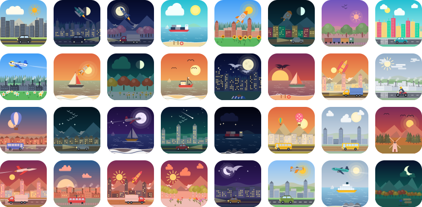

# vicon-avatars

[English](./README.md) · **简体中文** · [**在线演示**](https://victor-go.github.io/Vicon/)

确定性的风景图标生成器。输入任意字符串（用户 ID、邮箱、哈希），输出一幅小巧的 SVG 风景：天空、日月、云、飞机、山、城市天际线、路上的公交车……同一个字符串永远得到同一张图。

可以把它看作 [Jdenticon](https://jdenticon.com) 的另一种风格：不是抽象图案，而是一个个小世界。



- 6 个相互独立的图层，实际可达 **26.7 亿** 种组合（理论值 42.9 亿）
- 输出纯 SVG 字符串：不用 canvas、不用图片、不联网，单个图标约 6–16 KB
- 支持 **原生 JS、React、Vue、Angular**，也提供 **Web Component**
- 无运行时依赖，可 tree-shaking，同时提供 ESM、CJS 和类型声明
- 白天、黄昏、黑夜三套配色：夜晚窗户亮灯、星星出现，云和车辆随光线变暗

## 安装

```bash
npm install vicon-avatars
```

## 使用

### 原生 JS / Node

```js
import { toSvg } from 'vicon-avatars';

const svg = toSvg('alice@example.com', { size: 96, shape: 'circle' });
document.querySelector('#avatar').innerHTML = svg;
```

`toSvg` 返回完整的 `<svg>` 字符串，所以也能用在服务端（SSR、邮件、批量生成图片）。

### Node.js（服务端、脚本、命令行）

核心不依赖 DOM，可以在 Node 16+（ESM 和 CommonJS）以及 Next.js、Nuxt、Angular Universal 等 SSR 框架中直接使用。

```js
import { writeFileSync } from 'node:fs';
import { toSvg, toDataUri } from 'vicon-avatars';

writeFileSync('alice.svg', toSvg('alice@example.com', { size: 256 }));  // 保存为文件
const src = toDataUri('alice@example.com');                              // 用于 、CSS、Open Graph
// CommonJS：const { toSvg } = require('vicon-avatars');
```

Express 示例：`app.get('/avatar/:id.svg', (req, res) => res.type('svg').send(toSvg(req.params.id)))`。

### 保存为文件（SVG 或 PNG）

```js
import { saveAvatar, toPng } from 'vicon-avatars/node';

await saveAvatar('alice.svg', 'alice@example.com');                       // 按扩展名决定格式
await saveAvatar('alice.png', 'alice@example.com', { size: 256, scale: 2 }); // 512 px 的 PNG
const buffer = await toPng('alice@example.com', { size: 128 });           // Buffer，可直接作为 HTTP 响应
```

只有输出 PNG 需要一个可选依赖（SVG 不需要）：`npm install @resvg/resvg-js`。

命令行：

```bash
npx vicon-avatars alice@example.com -o alice.svg
npx vicon-avatars alice@example.com -o alice.png --shape circle --size 256 --scale 2
```

### 在浏览器里保存（下载按钮）

```js
import { downloadAvatar, toPngBlob } from 'vicon-avatars/browser';

downloadAvatar('alice', { format: 'png', size: 512 });   // 触发文件下载
const blob = await toPngBlob('alice', { size: 256 });    // 或拿到 Blob 自行上传
```

浏览器端用自带的 canvas 转换，不需要额外依赖。

### React

```tsx
import { Vicon } from 'vicon-avatars/react';

<Vicon value={user.id} size={64} shape="rounded" />
```

### Vue 3

```vue
<script setup>
import { Vicon } from 'vicon-avatars/vue';
</script>

<template>
  <Vicon :value="user.id" :size="64" shape="circle" />
</template>
```

### Angular（独立组件，需 v17.1+）

```bash
npm install vicon-avatars vicon-avatars-angular
```

```ts
import { ViconComponent } from 'vicon-avatars-angular';

@Component({
  standalone: true,
  imports: [ViconComponent],
  template: `<vicon [value]="user.id" [size]="64" shape="circle" />`,
})
export class AvatarComponent { user = { id: 'alice' }; }
```

### Web Component（任意框架）

```html
<script type="module">import 'vicon-avatars/element';</script>
<vicon-icon value="alice" size="64" shape="circle"></vicon-icon>
```

Angular 里也可以配合 `CUSTOM_ELEMENTS_SCHEMA` 直接使用 `<vicon-icon>`。

## 使用方式一览

| 你想要 | 用法 |
| ------ | ---- |
| 在页面里直接显示头像 | `<Vicon>`（React）、`<Vicon>`（Vue）、`<vicon>`（Angular）、`<vicon-icon>`（任意框架） |
| 一个 SVG 字符串 | `toSvg(value)` |
| 给 ``、CSS 或 meta 标签用的 `data:` URI | `toDataUri(value)` |
| 保存成磁盘文件（`.svg` / `.png`） | `vicon-avatars/node` 的 `saveAvatar(path, value)`，或命令行 |
| 服务端拿到 PNG 数据 | `vicon-avatars/node` 的 `toPng(value)` |
| 浏览器里的下载按钮 | `vicon-avatars/browser` 的 `downloadAvatar(value, { format })` |

## 选项

| 选项    | 类型                                | 默认值      | 说明                         |
| ------- | ----------------------------------- | ----------- | ---------------------------- |
| `value` | `string`                            | （必填）    | 任意字符串，相同输入得到相同图标 |
| `size`  | `number`                            | `128`       | 宽高，单位像素               |
| `shape` | `'rounded' \| 'circle' \| 'square'` | `'rounded'` | 外形：圆角 / 圆形 / 方形     |
| `title` | `string`                            | 即 `value`  | 无障碍标签（`aria-label`）   |
| `scale` | `number`                            | `1`         | 仅 PNG：像素倍数（`2` 即 2 倍图） |

### 底层 API

```js
import { select, renderInner, describe, LAYER_COUNTS, TOTAL_COMBINATIONS } from 'vicon-avatars';

select('alice');         // { sky: 0, deco1: 3, deco2: 77, scene: 0, mid: 127, fore: 102 }
describe('alice');       // { selection: {...}, palette: 'Clear Noon', time: 'day', scene: 'mountain' }
renderInner(select('alice'), 'circle'); // SVG 内容（viewBox 0 0 100 100）
```

## 图标由什么组成

每个字符串从六个图层中各选一项，由后往前绘制。

| # | 图层 | 数量 | 内容 |
| - | ---- | ---- | ---- |
| 1 | 天空配色 | 16 | 白天 6、黄昏 5、黑夜 5 套渐变，其余图层会随之调色 |
| 2 | 日 / 月 / 星 | 8 | 夜晚：星空、流星、各种月相；白天和黄昏：不同大小、光晕、颜色的太阳 |
| 3 | 天空物件 | 128 | 32 种云、24 种鸟群（海鸥、大雁、鹰）、24 种飞机、24 种热气球、24 种火箭 |
| 4 | 风景背景 | 16 | 高山、丘陵、雪山、平原、大海、森林山脊 |
| 5 | 风景中景 | 128 | 48 种城市天际线、48 种树林（松、橡、柏、桦、樱花、秋叶）、32 种船（仅海面） |
| 6 | 风景前景 | 128 | 64 种道路与车辆（大巴、轿车、SUV、货车、出租车、摩托、自行车）、火车、花田、栅栏农田、露营与路边小物；海面则是海滩场景 |

为了让场景合理，部分组合会被过滤：船只出现在海面，道路不会出现在水上，星星和月亮只在夜晚出现。

理论组合数：16 × 8 × 128 × 16 × 128 × 128 = **4,294,967,296**。过滤后实际可达约 **26.7 亿**。其中许多只是细节不同，肉眼能一眼区分的数量会少一些。

## 版本稳定性

图标是「字符串 + 包版本」的纯函数。在 `0.x` 阶段，不同版本之间图案可能会变。如果你要存储或比较图标，请锁定精确版本；从 `1.0` 起，图案改动会按破坏性变更处理。

## 在线演示（Playground）

**在线体验：[victor-go.github.io/Vicon](https://victor-go.github.io/Vicon/)**

输入任意字符串就能看到图标变化，可以逐层调整六个图层、切换形状、浏览随机画廊，并把结果下载为 SVG 或 PNG。页面会根据浏览器语言自动选择中文或英文，右上角可手动切换。

本地运行：

```bash
git clone https://github.com/Victor-Go/Vicon.git && cd Vicon
npm install
npm run dev        # http://localhost:5173
```

## 开发

```bash
npm run build           # 构建核心 + React + Vue + element 入口到 dist/
npm run build:angular   # 同时构建 Angular 包到 angular/dist/
npm run gallery         # 重新生成 docs/gallery.svg
npm run typecheck
npm test                # 构建后运行 Node 测试
```

## 许可证

MIT
